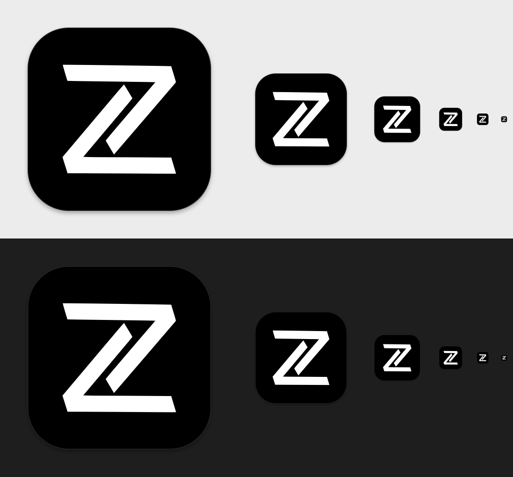

# Zymfonix IDE

The VS Code experience with Zymfonix's name, icon and identity.

Zymfonix IDE is an independent distribution of [Code - OSS](https://github.com/microsoft/vscode), the open-source project behind Visual Studio Code. It adds no features: editor, keyboard shortcuts, settings, themes and the extension system are unchanged. It is **not** a Microsoft product and is not affiliated with or endorsed by Microsoft.



## How it is built

| Layer | Source | Role |
| --- | --- | --- |
| Editor | [microsoft/vscode](https://github.com/microsoft/vscode) (Code - OSS), **stable** tags only | the actual application |
| Build tooling | [VSCodium/vscodium](https://github.com/VSCodium/vscodium) **release** tags | proven scripts that patch, build and package Code - OSS (telemetry off, Open VSX, no Microsoft branding) |
| This repository | Zymfonix | pins both, adds branding, builds and publishes releases |

`upstream.json` pins one VSCodium release and the Code - OSS tag/commit that release builds. Neither upstream is copied into this repository: the build clones VSCodium at the pinned commit into `.build/vscodium/`, and VSCodium's `get_repo.sh` clones Code - OSS at the pinned commit into `.build/vscodium/vscode/`. Each clone keeps its own `origin` remote (VSCodium and Microsoft respectively), so they never mix with this repository's history.

All Zymfonix changes are in four places and are re-applied to fresh upstream checkouts on every build:

- `branding/product.json`: names and identifiers, merged into VSCodium's `product.json` (which VSCodium merges last into Code - OSS's).
- `overlay/vscodium/`: icons, Linux launcher files and AppStream metadata, copied over VSCodium's `src/stable/`.
- `scripts/lib.sh`: the environment variables VSCodium's scripts already support (`APP_NAME`, `BINARY_NAME`, `GH_REPO_PATH`, `DISABLE_UPDATE`, ...).
- `scripts/apply-overlay.sh` and `scripts/post-prepare.sh`: a short list of exact text edits for things VSCodium hard-codes. Every edit asserts that the expected upstream text exists, so an upstream change stops the build instead of producing a half-branded app.

### Identity

| | Zymfonix IDE |
| --- | --- |
| Display name | Zymfonix IDE |
| Application / CLI name | `zymfonix-ide` |
| macOS bundle identifier | `com.zymfonix.ide` |
| URL protocol | `zymfonix-ide://` |
| Settings (macOS) | `~/Library/Application Support/Zymfonix IDE` |
| Settings (Linux) | `~/.config/Zymfonix IDE` |
| Extensions | `~/.zymfonix-ide/extensions` |

None of these are shared with Visual Studio Code, Code - OSS or VSCodium (`scripts/check-product.py` enforces this on every build), so Zymfonix IDE installs next to them without touching their settings, extensions or installation.

## Install

Download from the [latest release](https://github.com/poietikon/ZymfonixIDE/releases/latest).

### macOS

| Your Mac | Download |
| --- | --- |
| Apple Silicon (M1, M2, M3, M4, ...) | `ZymfonixIDE-<version>-macos-arm64.dmg` |
| Intel | `ZymfonixIDE-<version>-macos-x64.dmg` |

Not sure? Apple menu > **About This Mac**: "Chip: Apple M..." is Apple Silicon, "Processor: Intel..." is Intel. The Intel build also runs on Apple Silicon through Rosetta, but slower; use the arm64 build there.

1. Open the DMG and drag **Zymfonix IDE** to **Applications**.
2. Open Zymfonix IDE from Applications (or Launchpad / Spotlight).

**First launch (unsigned app).** Releases are signed ad hoc but not with an Apple Developer ID and not notarized, so macOS blocks the first launch:

1. On first open, macOS says it could not verify that Zymfonix IDE is free of malware. Click **Done** (not "Move to Trash").
2. Open **System Settings > Privacy & Security** and scroll to **Security**. Next to "Zymfonix IDE was blocked to protect your Mac", click **Open Anyway**.
3. Confirm with **Open Anyway** and your password or Touch ID.

This is the standard macOS approval for apps from outside the App Store without a Developer ID. It is needed once per installed version and does not change any system-wide security setting. (On macOS 14 and older, Control-click the app > **Open** > **Open** does the same.)

**Terminal command.** In Zymfonix IDE, run **Shell Command: Install 'zymfonix-ide' command in PATH** from the Command Palette (Cmd+Shift+P). Then `zymfonix-ide .` opens the current folder.

### Linux (x64)

- **Debian, Ubuntu and derivatives:** `sudo apt install ./zymfonix-ide_<version>_amd64.deb`. Adds the launcher entry, the icon and the `zymfonix-ide` command. Unlike Microsoft's package, it never adds a Microsoft apt repository.
- **Any distribution (AppImage):** `chmod +x ZymfonixIDE-<version>-linux-x86_64.AppImage`, then run it. Use a tool such as Gear Lever or AppImageLauncher to add it to the application menu.
- **Archive:** extract `ZymfonixIDE-<version>-linux-x64.tar.gz` and run `ZymfonixIDE-linux-x64/zymfonix-ide`.

The builds target glibc 2.28 or newer (Debian 10+, Ubuntu 20.04+, Fedora 29+, RHEL 8+).

### Verifying downloads

Every release has `SHA256SUMS.txt`. On Linux run `sha256sum -c --ignore-missing SHA256SUMS.txt` in the download folder; on macOS compare the output of `shasum -a 256 <file>` with the file's line in `SHA256SUMS.txt`.

## Updates: three different things

| What | How it happens |
| --- | --- |
| **Updating the Code - OSS version** this repository builds | Daily, `check-upstream.yml` looks for a new stable VSCodium release. If there is one, it opens a pull request that bumps `upstream.json` and runs CI on it. A maintainer merges it. Nothing is built or published by this step. |
| **Publishing a new Zymfonix IDE release** | A maintainer runs the Release workflow (or pushes a `v...` tag). It builds every platform, verifies every asset, and publishes a GitHub Release only if all of them succeeded. |
| **Updating an installed copy** | Manual. Installed copies do **not** update themselves: there is no update server. Download the new release and install it over the old one; settings and extensions are kept. |

The inherited VSCodium updater is disabled: there is no `updateUrl` in the app's `product.json` (so the update service reports "disabled"), updates default to off, VSCodium's update/download endpoints are not configured, the Rust CLI that embeds them is not built, and the AppImage has no self-updater. Zymfonix IDE never downloads VSCodium releases.

## Build it yourself

Normally you don't: GitHub Actions builds everything. To build locally you need macOS or Linux (x64), git, jq, python3, the Node.js version in `.build/vscodium/.nvmrc`, the usual native toolchain (Xcode command line tools / build-essential), and about **20 GB of free disk space**. A build takes one to three hours.

```bash
scripts/build.sh            # fetch pinned upstreams, apply branding, compile
scripts/package-macos.sh    # macOS: ad-hoc signed DMG + ZIP in dist/
scripts/verify-macos.sh     # macOS: check what was built
scripts/package-linux.sh    # Linux: .deb + .tar.gz in dist/
```

Quick checks that take minutes and no compiling:

```bash
scripts/lint.sh                      # shellcheck, JSON, icons, identifiers (actionlint if installed)
scripts/dry-run-prepare.sh --os osx  # apply all VSCodium patches + Zymfonix edits to Code - OSS
scripts/check-upstream.sh            # is a newer VSCodium/Code - OSS available?
```

### Icons

All icons are generated from the original logo, `branding/source/zymfonix.svg` (white Z on black; `zymfonix-invert.svg` is the inverted variant), by `branding/build-icons.sh` (macOS, needs `rsvg-convert` and ImageMagick). It places the logo's own paths on the macOS icon grid (824 px rounded tile on a 1024 px canvas, 22.5% corner radius, soft shadow), renders every size from vector, and writes the results into `overlay/vscodium/`, where they are committed. The macOS file-type icons are Code - OSS's with the Zymfonix mark in the corner. Run it again only when the logo changes:

```bash
scripts/fetch-upstream.sh && (cd .build/vscodium && . ./get_repo.sh)   # upstream icons to build on
branding/build-icons.sh
python3 branding/verify-icons.py
```

## Releasing

See [MAINTENANCE.md](MAINTENANCE.md). In short: Actions > **Release** > Run workflow. Versions are `<Code - OSS version><2-digit revision>`, e.g. `1.140.001` is the first Zymfonix release of Code - OSS 1.140.0; `00` is reserved for test builds.

## Known limitations

- **Extensions come from [Open VSX](https://open-vsx.org)**, not the Visual Studio Marketplace (Microsoft's terms allow the Marketplace only for Microsoft products). Most popular extensions are on Open VSX; some are not. You can install a `.vsix` file manually (Extensions view > ... > Install from VSIX) where the extension's license allows it.
- **Microsoft's proprietary extensions are not available or do not work**, for example Remote - SSH / WSL / Dev Containers, Live Share, Pylance, C# Dev Kit, and the GitHub Copilot integration that VSCodium removes. Open-source alternatives exist for some (e.g. basedpyright, Open Remote - SSH), with varying compatibility. Zymfonix IDE makes no claim of compatibility with Microsoft-proprietary extensions.
- **Settings Sync** with a Microsoft or GitHub account is not available; use profiles export/import instead.
- **No remote server and no tunnels:** the remote server (REH) and the `zymfonix-ide-tunnel` CLI are not built or published.
- **macOS builds are not notarized** (no Apple Developer Program membership); see the first-launch steps above.
- **Platforms:** macOS arm64/x64 and Linux x64 only. No Windows, Linux ARM, RPM or Snap builds.
- **Release lag:** Zymfonix IDE follows VSCodium releases, which usually trail Microsoft's VS Code releases by days to a few weeks.
- Telemetry is disabled, as in VSCodium.

## Repository layout

```
upstream.json               pinned VSCodium release + Code - OSS tag/commit
branding/                   original logo, product.json overrides, icon generator, previews
overlay/vscodium/           generated icons and Linux metadata, copied over VSCodium
scripts/                    fetch, overlay, build, package, verify, release and upstream-check scripts
.github/workflows/          ci.yml, build.yml, release.yml, check-upstream.yml
```

## License and attribution

The build tooling in this repository is MIT-licensed (see [LICENSE](LICENSE)). Zymfonix IDE is built from Code - OSS (MIT, Copyright Microsoft Corporation) with VSCodium's tooling (MIT, Copyright the VSCodium contributors); their copyright notices are kept in `LICENSE`, which is also shipped in the app as `LICENSE.txt`, and Code - OSS's `ThirdPartyNotices.txt` is shipped unchanged.

"Visual Studio Code" and "VS Code" are trademarks of Microsoft Corporation; VSCodium is a community project. The Zymfonix name and logo are Zymfonix's and are not licensed under the MIT license.
